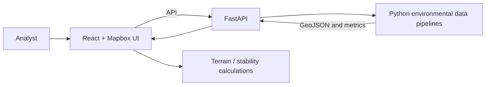

# Landslide Warning Software

A geospatial **landslide-analysis prototype** focused on **Lào Cai, Vietnam**, integrating environmental data retrieval with interactive terrain visualization.

> **Safety notice:** This software is **not a validated operational early-warning service**. Outputs must not be relied on as the sole basis for emergency or public-safety decisions.

## Project scope

- Interactive geospatial interface using **React, Vite, Mapbox GL and Turf.js**.
- Terrain calculations including slope, aspect, ruggedness, curvature and related indices.
- Experimental slope-stability indicators and rainfall-related alert logic.
- Python data pipelines for precipitation, soil moisture, vegetation indices and evapotranspiration.
- **FastAPI** backend with **Server-Sent Events (SSE)** for progress reporting.

Implementation does not, on its own, prove scientific validity or predictive performance.

## Architecture



## Technology

| Component | Technology |
| --- | --- |
| Web interface | React 19, Vite 8, JavaScript, Tailwind CSS |
| Mapping | Mapbox GL JS, Mapbox Draw, Turf.js |
| API | Python, FastAPI, Uvicorn, SSE |
| Scientific data | NASA-related datasets, NetCDF/HDF5, GeoJSON |

## Repository map

```text
src/App.jsx                 Interactive mapping UI
src/utils/                 Terrain/stability calculations
api_server.py              API and progress streaming
fetch_rainfall.py          Rainfall pipeline
fetch_smap.py              Soil moisture pipeline
fetch_ndvi.py              Vegetation index pipeline
fetch_et.py                Evapotranspiration pipeline
slope_units.py             Slope-unit processing
lao_cai_slope_units.geojson  Geographic data
vite.config.js             Local API proxy
```

## Development setup — known blockers

This is the intended development sequence, **not** a proven clean-machine installation.

1. Install Node.js/npm and Python with the required scientific/geospatial libraries.
2. Install web dependencies:

   ```bash
   npm ci
   ```

3. Configure local mapping in `.env.local`:

   ```dotenv
   VITE_MAPBOX_TOKEN=YOUR_DEVELOPMENT_MAPBOX_TOKEN
   ```

4. Configure NASA Earthdata credentials in your local backend environment; do not commit real secrets.
5. After installing the Python dependencies, run the API:

   ```bash
   uvicorn api_server:app --port 8000
   ```

6. In another terminal, start the web UI:

   ```bash
   npm run dev:fe
   ```

Vite proxies `/api` to `http://localhost:8000`.

**Portability limitations:**

- Python modules contain Windows-specific absolute paths for environment, cache and output locations. Replace these with configurable, relative paths before reusing the project on another computer.
- A complete pinned and verified Python dependency manifest is not yet established.
- External data access and reproducibility depend on upstream services, authentication and dataset availability.

## Source-level quality checks

```bash
npm run lint
npm run build
```

These commands are defined in the repository, but clean-environment success is not asserted.

## Scientific and public-safety boundaries

The repository has not established independently validated predictive accuracy, false-positive/false-negative rates, representative historical event evaluation, fail-safe behavior or readiness for operational early warning.

**Next steps:** Portable filesystem configuration, pinned Python dependencies, reproducible sample data, explicit scientific methodology, automated tests and out-of-sample evaluation.

**Scope:** Research and software-engineering prototype, not a certified public warning system.
